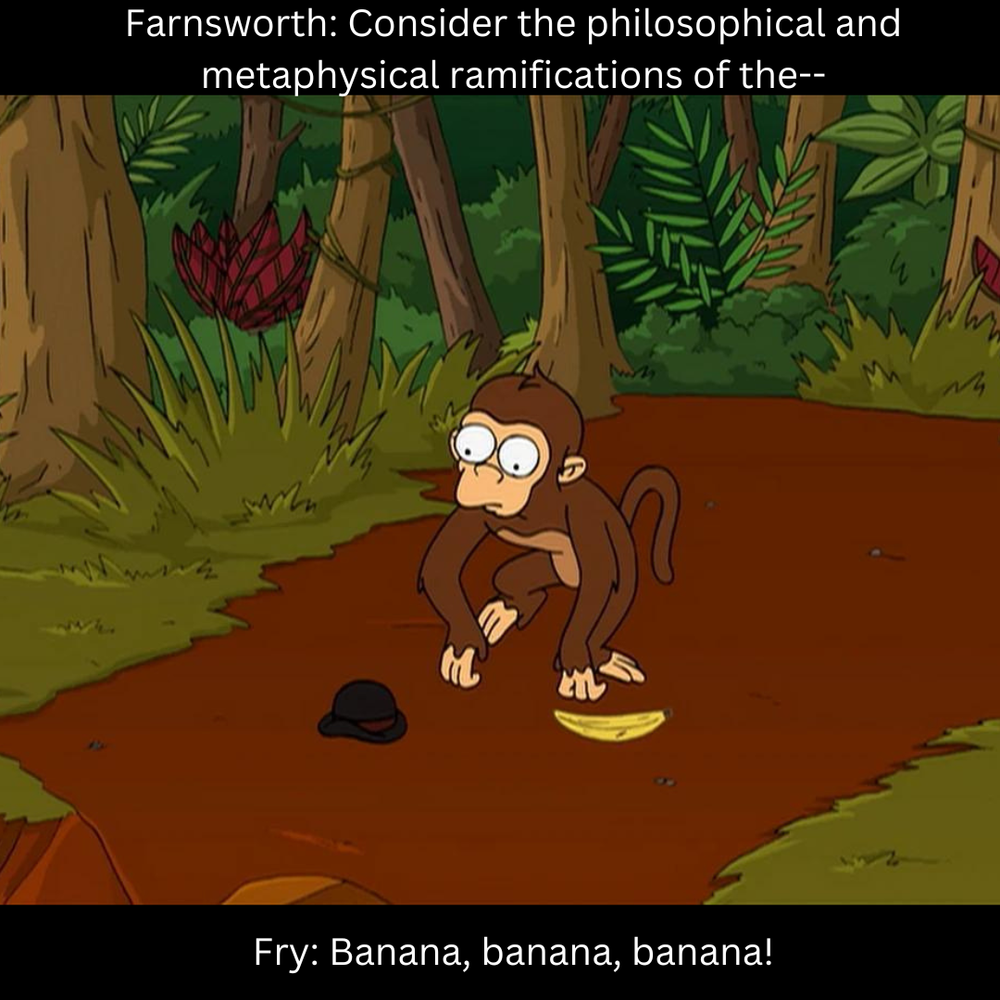

This repository contains all the projects developed during the International Master in Data Science.

All these project has been developed by the group of 6 - so the honor is not mine alone :)

## List of the projects:
1. Image recognition model: here we developed ML tool in order to detect the stage of ripeness of a set of banana image
2. Jupyter Notebook, Google Colab and Libraries for Data Science: we analize a dataset in order to understand which customers are more likely to subscribe and whether
Machine Learning can help identify promising customers for future campaigns.

# Project 1: Image Recognition Model
First project of this post-university program.

For our debut, we chose a dataset of banana images with the goal of developing a Machine Learning system to identify the ripeness level of bananas.

The dataset can be found here: https://universe.roboflow.com/zd7y6xooqnh7wc160ae7/banana-ripeness-classification

Want to know more? Take a look at the final report, where we explain in detail what we did and explore some possible real-world applications (hopefully nobody will steal our idea :) ).

Will we manage to pick the right banana, or will we end up like Guenter?

## Repository Content:
- `Group_Project_Image_Recognition_Business_Application`: task assignment
- `Banana_Ripeness_Recognition_System.ipynb`: Google Colab notebook
- `Fruit Ripeness Monitoring System for Smart Kitchen`: final report

# Project 2: Data Science Programming Languages and tools:
The second project, actually, is done by two different sub-project:
- The first one is a Python script where we analyzed a dataset provided by Marketing sector, 
- The second part is a a script written in R, where we analyzed IBM Telco Customer Churn dataset;

## Subproject 1: Jupyter Notebook, Google Colab & Libraries for Data Science

The dataset is here: https://archive.ics.uci.edu/dataset/222/bank+marketing and we have two different csv files: bank-additional-full (20 inputs) and bank-full (17 inputs). It's made by a set of questions to the customer (that's why most of the variables are categorical);

Will we end up like Fry? (Even though the pizza with anchovies could be a good reason :) )

## Subproject 2: Group_Assignment_R_Exploratory_Data_Analysis
The objective of the the script is to go beyond the examples discussed in class and investigate the dataset in greater depth. In particular, focus on features and relationships that were not examined, or were only briefly touched upon, during the lecture.

Anyway if we had the eyePhone the chourn would be zero :)

## Repository Content:
- `Group_Assignment_Juypter_Colanb_Data_Science`: task assignment for sub-group 1;
- `Group_Assignment_R_Exploratory_Data_Analysis`: task assignment for sub-group 2;
- `bank-additional-full.csv` (Subproject 1) with all examples (41188) and 20 inputs, ordered by date (from May 2008 to November 2010), very close to the data analyzed in [Moro et al., 2014];
- `bank-additional-full.txt` (Subproject 1) more details about this dataset; 
- `bank-full.csv` (Subproject 1) with all examples and 17 inputs, ordered by date (older version of this dataset with less inputs); the dataset we used into the script;
- `bank-full.txt` (Subproject 1) more details about this dataset;
- `Telco_customer_churn.xlsx` (Subproject 2) the dataset used in the script